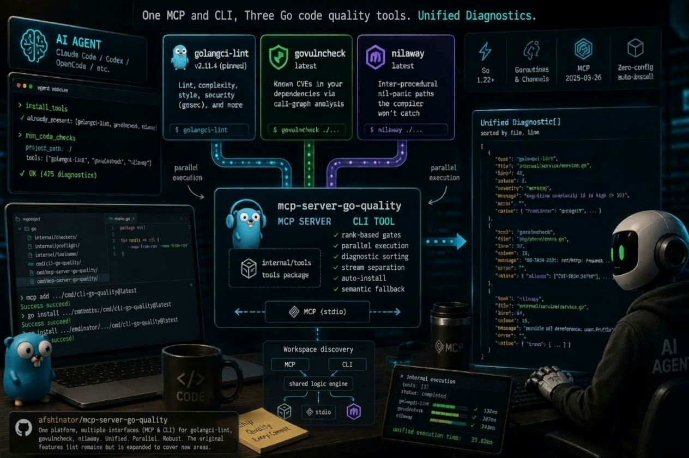

<div align="center">
  
</div>



# mcp-server-go-quality

**One MCP server for golangci-lint, govulncheck, and nilaway — a unified `Diagnostic[]` result with consistent file:line:column navigation, parallel execution, and zero-config auto-install.**

---

[](https://github.com/afshinator/mcp-server-go-quality/actions/workflows/test.yml)
[](https://goreportcard.com/report/github.com/afshinator/mcp-server-go-quality)
[](https://pkg.go.dev/github.com/afshinator/mcp-server-go-quality)
[]()
[](LICENSE)

---

## Demo


---

## What it does

Wraps three Go code quality tools behind one normalized result, and ships that
as **two entrypoints over one engine**:

| | |
|---|---|
| `go-quality` | a plain CLI for terminals, pre-commit scripts and CI |
| `mcp-server-go-quality` | an MCP server for Claude Code, Codex, OpenCode and other agents |

Both run the same three checkers in parallel under independent timeouts, return
the same `{"diagnostics": [...]}` envelope, resolve the same `.go-quality.yaml`,
and auto-install the same pinned tool versions. Pick by how you want to call it,
not by what it can do.

| Concern | Raw tools | This project |
|---|---|---|
| Entry points | 3 separate `go install` + invocation | 1 CLI run or 1 MCP tool call |
| Output format | 3 incompatible schemas | 1 unified `Diagnostic[]` result |
| Tool install | Manual per machine | Auto-install with version pinning |
| Concurrency | Sequential by default | Parallel goroutines, per-tool timeouts |
| Error handling | Parse exit codes and stderr manually | Canonical `error` field per diagnostic, panic recovery |
| Path normalization | Raw absolute paths | Relative to project root |
| Workspace support | Manual `go.work` parsing | Two-pass root discovery (`go.work` > `go.mod`) |

One caveat worth knowing before you build a gate on it: `severity` is populated
from the tool's own reporting where it exists, but **govulncheck and nilaway have
no severity concept** and golangci-lint reports one only when the repository
config defines severity rules. Findings with no tool-reported severity are
labelled `error`, so an unlabelled finding never sorts below a style warning —
but that also means `--fail-on=warning` and `--fail-on=error` currently behave
alike. Gate on `--fail-on=any`, or on `--tools=govulncheck` for security only.

---

## Tools bundled

| Tool | Version | Checks |
|---|---|---|
| [golangci-lint](https://golangci-lint.run) | **v2.14.0** (pinned) | Lint violations, complexity (`gocyclo`/`gocognit`), security (`gosec`) |
| [govulncheck](https://pkg.go.dev/golang.org/x/vuln/cmd/govulncheck) | **v1.9.0** (pinned) | Known CVEs reachable from your code via call-graph analysis |
| [nilaway](https://github.com/uber-go/nilaway) | **v0.0.0-20260918162853-acb8859b9031** (pinned) | Inter-procedural nil-panic paths the compiler won't catch |

---

## Interoperability between the two entrypoints

The CLI's `--json` output is byte-identical to the MCP tools' `structuredContent`
— same envelope, same field order, same values — so one consumer works against
either:

```bash
jq '.diagnostics' <(go-quality --json .)
```

The only difference is stream usage: the CLI writes the payload to stdout and
progress/summary to stderr, while the MCP server writes JSON-RPC to stdout and
logs to stderr.

---

## MCP tools exposed

| Tool | Description |
|---|---|
| `run_code_checks` | Run all 3 checkers in parallel (or a subset via `tools` param). Returns `{"diagnostics": [...]}`, sorted `Diagnostic[]` inside. |
| `run_lint` | Run golangci-lint only. |
| `run_vuln_check` | Run govulncheck only. |
| `run_nil_check` | Run nilaway only. |
| `install_tools` | Pre-install all three tools at their pinned versions. Call this at session start. |

---

## Output schema

Every check tool returns a sorted `Diagnostic[]` wrapped in a `diagnostics`
object, sorted by `file` then `line`. The same JSON is returned as
`structuredContent` (validated against each tool's declared `outputSchema`) and
as a text content block for backward compatibility:

```json
{
  "diagnostics": [
    {
      "tool": "golangci-lint",
      "file": "cmd/main.go",
      "line": 115,
      "column": 1,
      "severity": "warning",
      "message": "cognitive complexity 18 is high (> 15)",
      "error": "",
      "native": {"FromLinter": "gocognit", "Text": "...", "SuggestedFixes": [...]}
    }
  ]
}
```

`install_tools` returns its own object: `{ "installed": [], "already_present": [], "failed": [] }`.

| Field | Notes |
|---|---|
| `severity` | Always present on a finding. govulncheck and nilaway have no severity concept, and golangci-lint reports one only when the repo config defines severity rules, so a finding whose tool reports none is labelled `error` rather than left empty. Absent **only** on error diagnostics, which are tool failures. |
| `native` | Full raw tool output. `null` for error diagnostics that carry no raw context. Govulncheck parse errors carry raw error strings as a JSON array. |
| `error` | Non-empty on tool failure or panic. **Check this first** before reading `file`/`line`. |

---

## Installation

### For AI agents (Claude Code, etc.)

```bash
claude mcp add go-quality -- go run github.com/afshinator/mcp-server-go-quality/cmd/mcp-server-go-quality@latest
```

For other MCP clients, add to your config:

```json
{
  "mcpServers": {
    "go-quality": {
      "command": "mcp-server-go-quality",
      "args": []
    }
  }
}
```

### For humans (local install)

Two binaries share one engine. The CLI is what you want in a terminal, a
pre-commit script or CI; the MCP server is for agents that speak the protocol.

**Stable install — release `v0.1.0`:**

```bash
# CLI
go install github.com/afshinator/mcp-server-go-quality/cmd/go-quality@v0.1.0

# MCP server
go install github.com/afshinator/mcp-server-go-quality/cmd/mcp-server-go-quality@v0.1.0
```

Or grab a release archive from the
[releases page](https://github.com/afshinator/mcp-server-go-quality/releases) —
one per platform (linux/darwin/windows, amd64/arm64), each containing **both**
binaries plus the CHANGELOG and LICENSE.

**Tracking the default branch:** `@latest` resolves to the newest commit on
`main`, so it can move between releases. Fine for trying it out; pin `@v0.1.0`
for anything a gate depends on.

#### CLI

```bash
cd ~/my-go-project
go-quality                      # text on stdout, non-zero if anything is found
go-quality --json | jq '.diagnostics'   # the same envelope the MCP tools return
go-quality --tools=golangci-lint        # fast subset
go-quality --fail-on=none               # report but never fail on findings
```

Exit codes: `0` clean, `1` a finding reached `--fail-on`, `2` the run did not
complete (a checker failed to run, the config was unusable, or a flag was
invalid). A tool that failed to run is **always** exit 2, even under
`--fail-on=none` — a checker that never ran is not a clean result.

stdout carries only the payload for the mode. Progress, install messages and the
summary go to stderr, so `go-quality --json | jq` is never corrupted by a
first-run tool install. Tools auto-install into `$GOBIN` on first use; use
`--install-only` to pre-warm them in CI without running a check.

`--json` is byte-identical to the MCP tools' `structuredContent`: same envelope,
same field order, same values. One `jq` query works against either entrypoint.

#### MCP server

```bash
cd ~/my-go-project
mcp-server-go-quality
# Or specify a project path and config:
mcp-server-go-quality --config ./my-config.yaml
```

The server starts in stdio mode — connect any MCP client or test it interactively by piping JSON-RPC. Tools auto-install into `$GOBIN` on first use.

**Prerequisites:** Go 1.26+ on `PATH` (the toolchain directive in `go.mod` downloads the exact required version automatically).

---

## Agent workflow

1. **Install tools** — call `install_tools` at session start. Returns `installed`, `already_present`, and `failed` lists. A fast no-op if binaries are at the correct version.
2. **Run checks** — call `run_code_checks` with `project_path` set to the project root (or any subdirectory — the server walks up to `go.work` or `go.mod`).
3. **Process diagnostics** — check `error` first (non-empty = tool failure), then navigate to `file:line:column`. The `native` field carries full raw output for remediation.

Full contract and processing loop: **[docs/agents/AGENTS.md](docs/agents/AGENTS.md)**  
Error tables, remediation, and troubleshooting: **[docs/agents/reference.md](docs/agents/reference.md)**

---

## Configuration (`.go-quality.yaml`)

Place at the project root. All fields optional.

```yaml
timeout: 5m          # per-tool deadline; increase for big monorepos or first vuln DB download

tools:
  golangci-lint:
    version: v2.14.0
    extra_args: []
  govulncheck:
    version: v1.9.0   # pinned
    extra_args: []
  nilaway:
    version: v0.0.0-20260918162853-acb8859b9031   # pinned
    extra_args: ["--exclude-pkgs=github.com/myorg/vendor"]
```

Precedence: `--config` flag > `.go-quality.yaml` at server CWD > compiled-in defaults.

---

## Go workspace support

Supports single-module `go.mod` and `go.work` multi-module workspaces. Pass any subdirectory as `project_path` — the server walks up to find `go.work` first, then `go.mod`. Nilaway automatically collects module paths from `use` directives and passes them via `-include-pkgs`.

---

## Contributing

TDD enforced — nearly every source file has a companion `_test.go` file. Integration tests run against [`testdata/sample_project/`](testdata/sample_project/), a small Go module with intentional issues for all three tools.

Open work and known gaps are tracked in [TODO.md](TODO.md). The MCP-currency
audit and its evidence are in [docs/mcp-spec-currency.md](docs/mcp-spec-currency.md).

Use `make bump-tool-pins` to resolve the latest versions and update every tool pin.
Cutting a release is documented in [`RELEASING.md`](RELEASING.md).
The scheduled pin-drift workflow checks those pins against the module proxy.

Example configs live under [`examples/config/`](examples/config/), and
[`examples/mcp-clients/`](examples/mcp-clients/) covers registering the MCP
server with Claude Desktop, Cursor, Gemini CLI, Codex and other harnesses.
[`examples/agents/AGENTS.md`](examples/agents/AGENTS.md) is a drop-in
instruction file a project can ship so any MCP-capable agent knows to run the
checks and how to act on them.

```bash
make test       # unit tests (fast)
make test-all   # full suite including integration
make lint       # golangci-lint
make fmt        # gofumpt + goimports
make build      # compile the binary
```

---

MIT License
